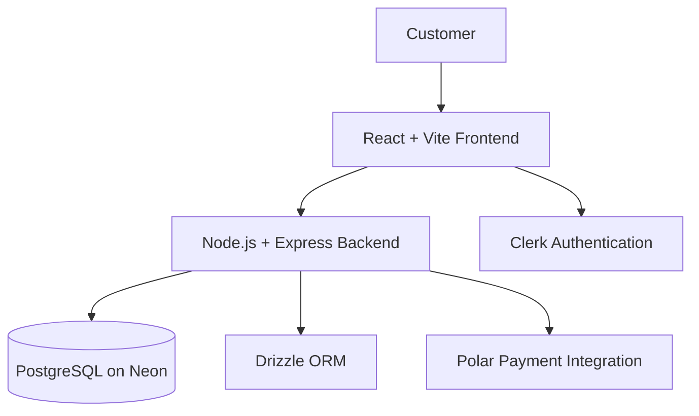

<div align="center">

# 🛍️ NovaCart

### A modern full-stack shopping experience

A full-stack e-commerce application featuring product discovery, a shopping cart, authentication, checkout integration, and order history.

<br />

[](https://e-commerce-4ji0.onrender.com)
[](https://github.com/Chaitanya100000/E-Commerce)

<br />

**Built with React · Node.js · Express · PostgreSQL · Drizzle ORM · Clerk · Polar**

</div>

---

## ✨ Overview

**NovaCart** is a full-stack e-commerce project built to demonstrate how a modern online shopping application can bring together a responsive frontend, backend services, persistent data, authentication, and payment integration.

The interface uses a dark theme with green accents and includes a product catalog, category filters, cart management, checkout entry point, and order history.

> 🌐 **Try it:** [e-commerce-4ji0.onrender.com](https://e-commerce-4ji0.onrender.com)  
> Some routes or features may require signing in. Payment and webhook behavior depends on the configured third-party services.

## 🚀 Highlights

| Feature | Description |
|---|---|
| 🛍️ **Product catalog** | Browse products with images, descriptions, prices, and category filters. |
| 🛒 **Cart management** | Review cart items, update quantities, remove products, and view the subtotal. |
| 🔐 **Authentication** | User authentication integrated with Clerk. |
| 💳 **Payment workflow** | Polar integration for checkout and payment-related processing. |
| 📦 **Order history** | View order dates, payment status, item counts, and totals. |
| 🗄️ **Persistent data** | PostgreSQL database with Drizzle ORM. |
| 💬 **Order support UI** | The interface advertises order-scoped support chat and optional video for paid orders; verify the flow in the live app. |
| ☁️ **Deployment** | Hosted demo available online. |

## 🖼️ Screenshots

> Save your real application screenshots in the `screenshots/` directory using the filenames shown below.

### 🏠 Homepage


### 🧭 Product catalog


### 🛒 Shopping cart


### 📦 Order history


## 🧰 Technology Stack

<div align="center">

| Frontend | Backend | Database & integrations |
|---|---|---|
| React | Node.js | PostgreSQL |
| Vite | Express.js | Neon |
| JavaScript | REST API services | Drizzle ORM |
|  |  | Clerk Authentication |
|  |  | Polar Payments |

</div>

## 🏗️ High-level architecture



The frontend presents the shopping experience and communicates with backend services. The backend handles application logic and database operations. Clerk and Polar provide authentication and payment-related capabilities.

## 📁 Project structure

```text
E-Commerce/
├── backend/
├── frontend/
├── screenshots/
│   ├── homepage.png
│   ├── products.png
│   ├── cart.png
│   └── orders.png
├── Dockerfile
├── package.json
├── package-lock.json
└── README.md
```

*This is a high-level overview; the exact files and scripts are defined by the repository.*

## ⚙️ Run locally

### Prerequisites

Before starting, install or configure:

- [Node.js](https://nodejs.org/) and npm
- [Git](https://git-scm.com/)
- A PostgreSQL database (for example, Neon)
- Clerk credentials for authentication
- Polar credentials and webhook configuration if testing payment flows

### 1. Clone the repository

```bash
git clone https://github.com/Chaitanya100000/E-Commerce.git
cd E-Commerce
```

### 2. Install dependencies

Install dependencies in each app directory that contains a `package.json`. For example, if `frontend/` and `backend/` each have their own package file:

```bash
cd frontend
npm install

cd ../backend
npm install
```

If the root `package.json` defines workspace commands or additional setup steps, follow those as well.

### 3. Configure environment variables

Create local `.env` files in the locations expected by your frontend and backend. Confirm exact variable names from the code or existing environment examples.

Your setup may require configuration for:

- PostgreSQL connection string
- Clerk publishable key and server-side secret key
- Polar credentials and webhook secret
- Frontend and backend URLs
- CORS origins and any other service-specific settings

**Never commit `.env` files, private keys, tokens, or production credentials to GitHub.**

### 4. Set up the database

Configure PostgreSQL, then run the migration or schema commands defined by the backend's `package.json` and Drizzle configuration. If the application requires seeded products, run the repository's seed script.

### 5. Start the application

Use the development scripts defined in the relevant `package.json` files. A Vite frontend commonly starts with:

```bash
npm run dev
```

Run that command from the frontend directory if its `package.json` defines it. Start the backend using its configured development script in a separate terminal.

> Script names can vary. Check each `package.json` before running commands.

## 🔒 Security practices

- Store secrets in environment variables, not source code.
- Keep database credentials and Clerk/Polar secrets private.
- Verify payment webhook signatures on the server.
- Never trust a client-side redirect alone as confirmation of a successful payment.
- Use test accounts and payment test mode during development.
- Avoid including customer data, order identifiers, or sensitive information in public screenshots.

## 🧠 What this project demonstrates

- Full-stack JavaScript application development.
- Connecting a React frontend to backend services.
- Authentication integration with Clerk.
- PostgreSQL data modeling and database operations using Drizzle ORM.
- Payment workflow integration and webhook handling.
- Environment configuration and deployment troubleshooting.
- Building a cohesive shopping UI with product, cart, and order screens.

## 🗺️ Potential next improvements

- Add automated tests for cart, checkout, and order workflows.
- Improve loading, empty, and error states.
- Add accessibility and responsive-layout checks.
- Add monitoring and structured server-side logging.
- Document exact API routes and environment variables for contributors.

## 👨‍💻 Developer

**Chaitanya Takale**

- GitHub: [@Chaitanya100000](https://github.com/Chaitanya100000)
- Repository: [NovaCart — E-Commerce](https://github.com/Chaitanya100000/E-Commerce)
- Live demo: [NovaCart](https://e-commerce-4ji0.onrender.com)

---

<div align="center">

**Thanks for checking out NovaCart!** ⭐

If you have feedback or find a bug, please open an issue in the repository.

</div>
