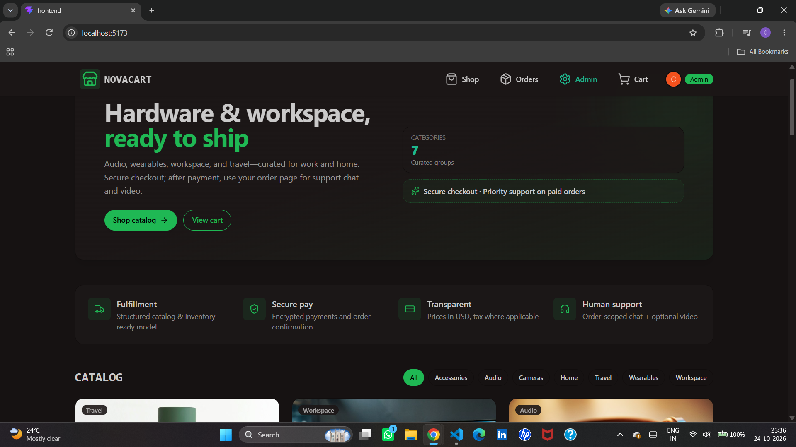
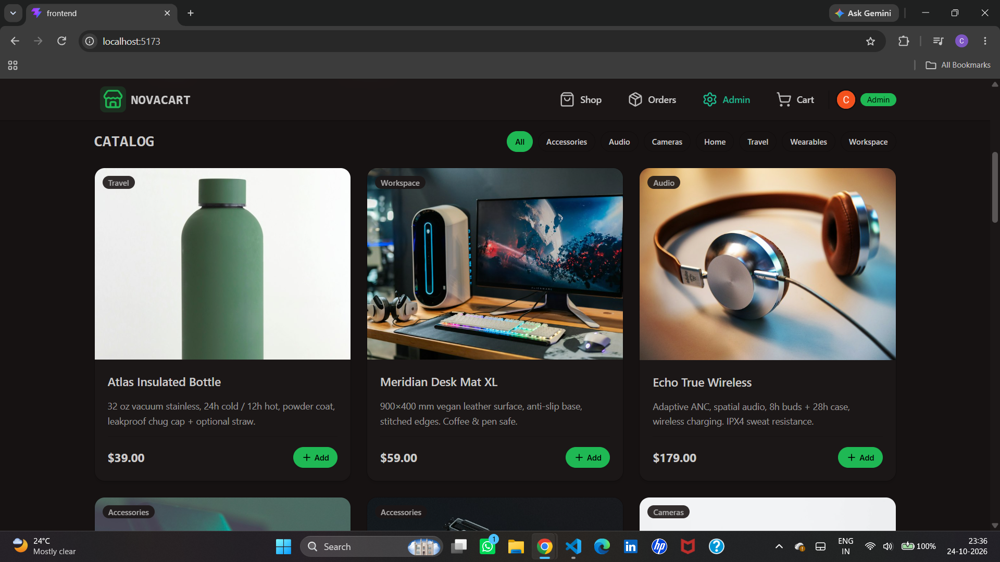
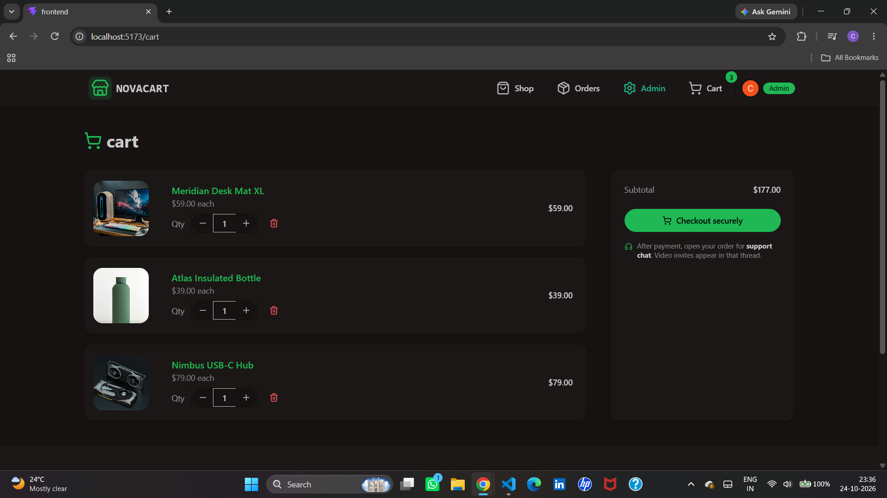
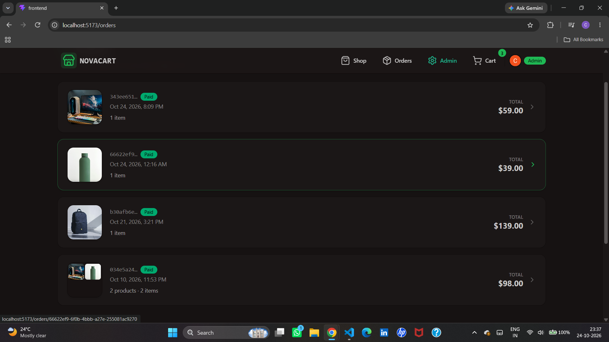

# NovaCart — Full-Stack E-Commerce Platform

A full-stack e-commerce application built with React, Node.js, Express, PostgreSQL, Drizzle ORM, Clerk, and Polar. NovaCart demonstrates an end-to-end shopping experience, from browsing products and managing a cart to checkout and order history.

<p align="center">
  <a href="https://e-commerce-4ji0.onrender.com"><strong>Live Demo</strong></a>
  ·
  <a href="https://github.com/Chaitanya100000/E-Commerce"><strong>GitHub Repository</strong></a>
</p>

> **Note:** The live application may require sign-in. Some integrations, such as checkout and order processing, depend on their configured third-party services.

## Screenshots

Screenshots are stored in the repository's `screenshots/` directory. Add your actual screenshots using these filenames.

### Homepage


### Product catalog


### Shopping cart


### Order history


## Features

- **Product catalog:** Browse products with images, descriptions, prices, and category filters.
- **Shopping cart:** Review selected products, adjust quantities, remove items, and view the subtotal.
- **Authentication:** User authentication through Clerk.
- **Checkout and payments:** Polar integration for the payment workflow.
- **Order history:** View orders, payment status, order dates, item counts, and totals.
- **Database integration:** PostgreSQL for persistent application data.
- **Database access and schema management:** Drizzle ORM.
- **Backend API:** Node.js and Express services for application functionality.
- **Support experience:** The interface describes order-scoped support chat and optional video for paid orders; verify these flows in the deployed app before relying on them.

## Tech Stack

| Area | Technology |
|---|---|
| Frontend | React, Vite, JavaScript |
| Backend | Node.js, Express.js |
| Database | PostgreSQL, Neon |
| ORM | Drizzle ORM |
| Authentication | Clerk |
| Payments | Polar |
| Deployment | Render |

## Architecture

NovaCart is organized as a frontend and backend application. The frontend provides the shopping interface and communicates with backend services. The backend handles application logic and database operations, while Clerk and Polar provide authentication and payment-related integrations.

```text
Customer
   |
   v
React + Vite frontend
   |
   v
Node.js + Express backend
   |
   +---- PostgreSQL (Neon)
   |       via Drizzle ORM
   |
   +---- Clerk authentication
   |
   +---- Polar payment integration
```

## Project Structure

```text
E-Commerce/
├── backend/
├── frontend/
├── Dockerfile
├── package.json
├── package-lock.json
├── screenshots/
│   ├── homepage.png
│   ├── products.png
│   ├── cart.png
│   └── orders.png
└── README.md
```

> This is a high-level structure. The exact files and scripts may vary in your repository.

## Live Demo

**Website:** https://e-commerce-4ji0.onrender.com

Try browsing the catalog, adding products to the cart, and reviewing the order history after signing in. Use a test payment configuration when testing checkout. Never use real payment details in screenshots or demonstrations.

## Run Locally

### Prerequisites

- Git
- Node.js and npm
- Access to a PostgreSQL database
- Clerk credentials for local authentication
- Polar credentials and webhook configuration if testing payment flows

### 1. Clone the repository

```bash
git clone https://github.com/Chaitanya100000/E-Commerce.git
cd E-Commerce
```

### 2. Install dependencies

Install dependencies in each application directory that contains a `package.json`. For example, if both `frontend/` and `backend/` have their own package files:

```bash
cd frontend
npm install

cd ../backend
npm install
```

If the root `package.json` defines a workspace or additional scripts, follow the instructions in that file as well.

### 3. Configure environment variables

Create local `.env` files in the locations expected by the frontend and backend. Check the code and existing environment examples to confirm the exact variable names.

Configure the values required by your setup, such as:

- PostgreSQL connection string
- Clerk publishable key and server-side secret key
- Polar access credentials and webhook secret
- Frontend/backend URLs and any required CORS origins

Do not copy production secrets into public files. Do not commit `.env` files or credentials to GitHub.

### 4. Set up the database

Configure your PostgreSQL database and run the migration or schema commands defined in the backend's `package.json` and Drizzle configuration. If the project requires seed data, run the seed script documented by the repository.

### 5. Start the development servers

Use the actual scripts defined in each application's `package.json`. Common Vite projects use `npm run dev` for the frontend; the backend command depends on its configured scripts.

Keep the frontend and backend terminals running while testing locally. Ensure the configured frontend URL, backend URL, authentication settings, and CORS origins match your local environment.

## Environment and Security

- Keep database URLs, Clerk secret keys, Polar credentials, and webhook secrets private.
- Use environment variables for secrets and environment-specific configuration.
- Never commit `.env` files, access tokens, or real customer data.
- Validate payment webhook signatures on the server before applying payment-related changes.
- Do not treat a client-side redirect or success page as proof that a payment succeeded.
- Use test-mode payments and test accounts for development and demonstrations.

## What I Learned

Building NovaCart provided hands-on practice with:

- Developing a full-stack JavaScript application.
- Integrating third-party authentication with Clerk.
- Working with PostgreSQL and Drizzle ORM.
- Building and connecting frontend and backend services.
- Integrating payment workflows and webhooks with Polar.
- Configuring environment variables and deployment settings.
- Debugging issues across the frontend, backend, database, and third-party services.

## Future Improvements

Potential next steps include automated tests for critical shopping and payment flows, improved error handling and observability, accessibility checks, and performance optimization.

## Developer

**Chaitanya Takale**

- GitHub: [Chaitanya100000](https://github.com/Chaitanya100000)
- Project repository: [E-Commerce / NovaCart](https://github.com/Chaitanya100000/E-Commerce)
- Live demo: [NovaCart](https://e-commerce-4ji0.onrender.com)

---

If you find a problem or have a suggestion, please open an issue in the GitHub repository.
